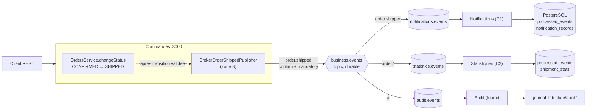

# Architecture TP5 — un événement publié, une queue par abonnement

## Vue d'ensemble



Les ressources du TP4 (`orders.commands` → `orders.prepare`, retries 2/5/10 s, DLQ) sont **inchangées** : la préparation est une **Work Queue** (un message = une tâche, partagée entre les workers d'une même queue). Ici c'est du **Publish/Subscribe** : un événement = un fait, **chaque queue** en reçoit une copie, et seuls les workers *d'une même queue* se partagent ses livraisons. Les événements `OrderShipped` ne passent jamais par `orders.prepare`.

## Topologie (déclarée dans `docker/rabbitmq/definitions.json`, appliquée par `npm run setup`)

| Ressource | Type / valeur | Rôle |
|---|---|---|
| `business.events` | exchange **topic**, durable | Seul exchange sur lequel le producteur publie ; routing key `order.shipped` |
| `notifications.events` | queue durable, binding `order.shipped` | Abonnement Notifications |
| `statistics.events` | queue durable, binding `order.*` | Abonnement Statistiques |
| `audit.events` | queue durable, binding `#` | Abonnement Audit (reçoit tout) |
| `<c>.events.retry` | queue durable, TTL 3 s | Retry **propre** au consommateur `<c>` |
| `<c>.events.dlq` | queue durable | DLQ **propre** au consommateur `<c>` |
| `business.retry` · `business.requeue` · `business.dead` | exchanges **direct**, durables | Circuits d'erreur (une clé par consommateur) |
| `orders.commands`, `orders.prepare`, `orders.retry*`, `orders.prepare.dlq`… | TP4, inchangés | Préparation asynchrone |

### Circuit d'erreur d'un consommateur `<c>`

```
<c>.events --(retryLater)--> business.retry [<c>.retry] --> <c>.events.retry (TTL 3 s)
                                                              └─ dead-letter → business.requeue [<c>] → <c>.events
<c>.events --(deadLetter : nack requeue=false)--> business.dead [<c>] --> <c>.events.dlq
```
- **Isolation** : chaque consommateur a ses propres files **et** ses propres clés ; ces exchanges `direct` ne sont liés à aucune autre queue. Un retry de Statistiques ne peut donc pas être rediffusé vers Notifications ni Audit (ce qui arriverait si l'on republiait vers `business.events`).
- **Politique bornée** : au plus **3 retries** espacés d'au moins 3 s (un TTL est un délai minimal), puis DLQ. Le compteur est l'en-tête AMQP `x-retry-count` ; le corps de l'événement et son `eventId` ne changent jamais.
- On ne réutilise pas telles quelles les files `orders.retry.*` du TP4 : leur dead-letter ramène vers `orders.commands`/`order.prepare`, c'est-à-dire dans la Work Queue de préparation.
- Aucun `nack(requeue=true)` n'est exposé aux handlers (redelivery immédiate et infinie) et aucun ACK silencieux d'un message invalide.

## Composants

| Composant | Où | Rôle |
|---|---|---|
| Contrat + validation | `packages/contracts/src/events.ts`, `topology.ts` | Types `OrderShippedEvent`, `validateOrderShipped*`, noms de la topologie (pas de fabrique d'enveloppe : zone B) |
| Publisher confirmé | `packages/messaging` | Confirm Channel + `mandatory` + `basic.return` ; `PublishError` (`unroutable`, `nacked`, `outcome-unknown`, `broker-unavailable`) |
| Publication d'événement | `apps/order-service/src/events/order-shipped-publisher.ts` + `services/orders.service.ts` | **Zone B** |
| Runtime des consommateurs | `apps/event-workers/src/runtime/` | Connexion, ACK manuel, prefetch 1, retry borné, DLQ, reconnexion, arrêt propre |
| Handlers | `apps/event-workers/src/handlers/` | `audit` (fourni) · `notifications` (**C1**) · `statistics` (**C2**) |
| Base | `database/migrations/002_tp5_events.sql` | Une base partagée pour ce TP, frontières logiques par `consumer_name` |
| Laboratoire | `scripts/lab/*`, `apps/*/src/lab-*.ts` | Injections explicites ; refusées si `NODE_ENV=production` |

### Frontières logiques (une seule base dans ce TP)
- `processed_events(consumer_name, event_id)` — clé primaire composite : la déduplication est **par consommateur** (`notifications-worker`, `statistics-worker`).
- `notification_records` appartient à Notifications ; `shipment_stats` à Statistiques ; Audit n'utilise pas PostgreSQL (journal de fichiers, une technique d'idempotence différente).

## Garanties à connaître (et à expliquer en soutenance)
- **Livraison au moins une fois** : « reçu » ≠ « acquitté » ≠ « traité ». L'ACK RabbitMQ et le COMMIT PostgreSQL ne partagent aucune transaction.
- **Publication** : un *confirm* positif ne prouve pas le routage (`basic.return` arrive avant le `basic.ack`) ; `mandatory` sert à détecter l'absence de queue liée.
- **Entre l'enregistrement de la transition et la publication**, un arrêt du processus perd l'événement : voir test T7 (analyse demandée ; la solution complète est une extension facultative).
- **Persistance** : queues durables + messages persistants survivent à un redémarrage du broker, mais pas à une perte de disque ; les queues classiques ne sont pas répliquées (voir `docs/limitations.md`).

## Chronologie (80 min)
A 8 min · B 15 min · C 17 min · D 15 min · E 13 min · F 12 min — groupes de 2 à 4. Détail et livrables : `README.md`.
